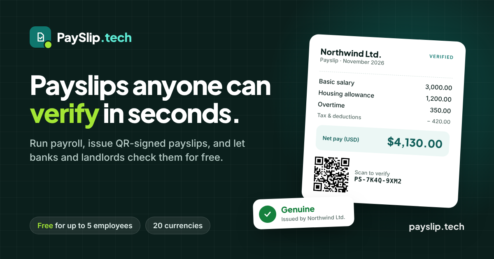
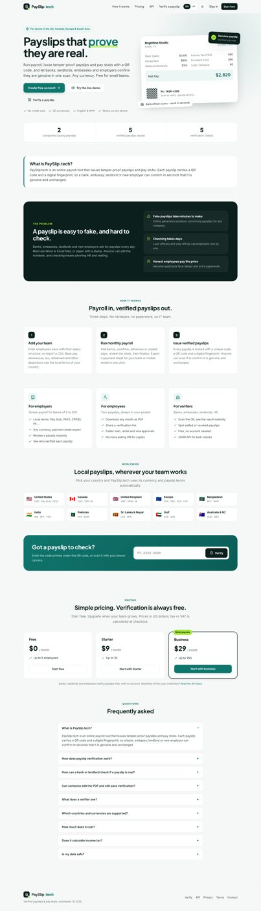
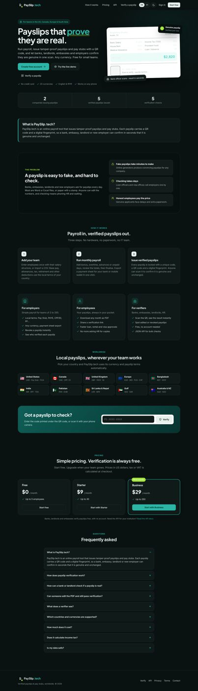
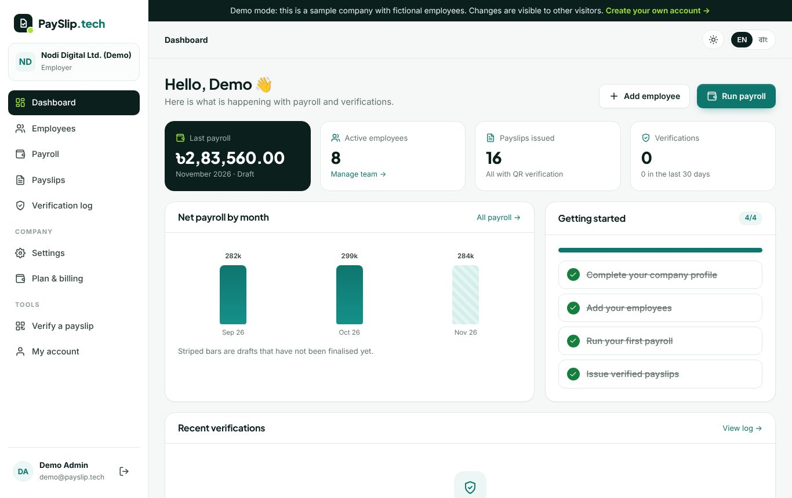
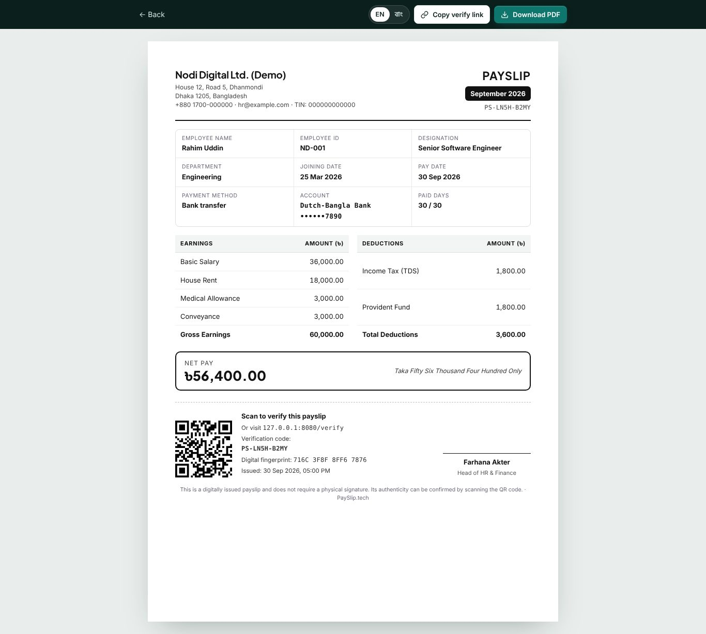
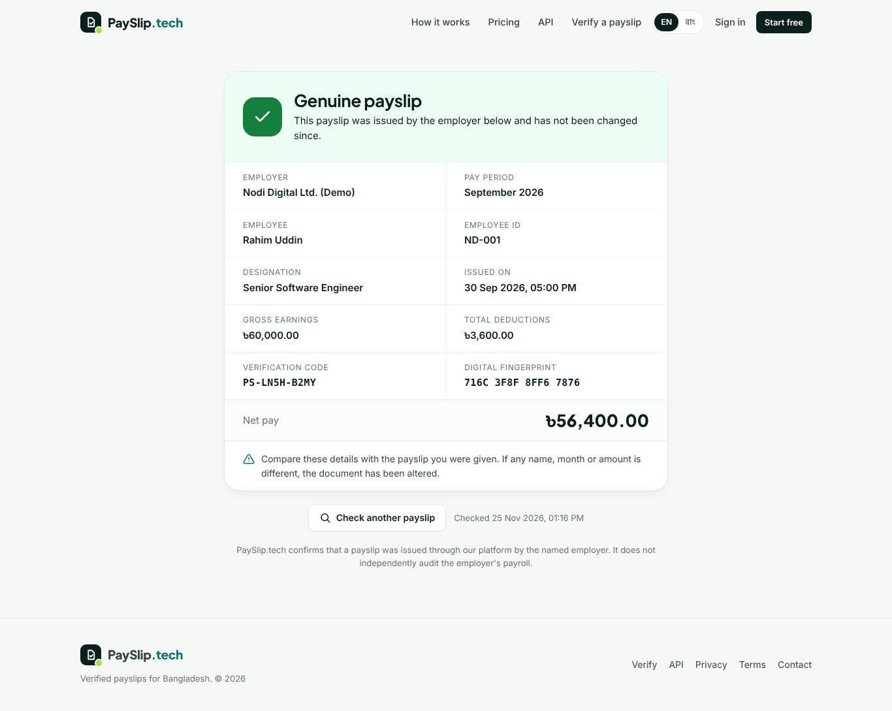
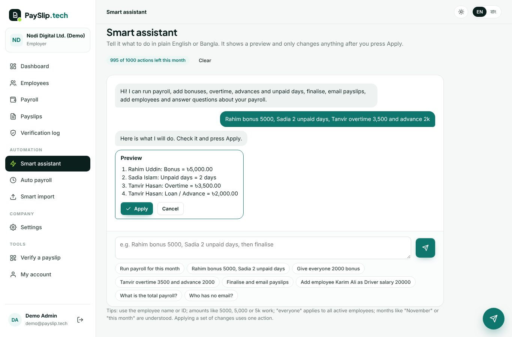
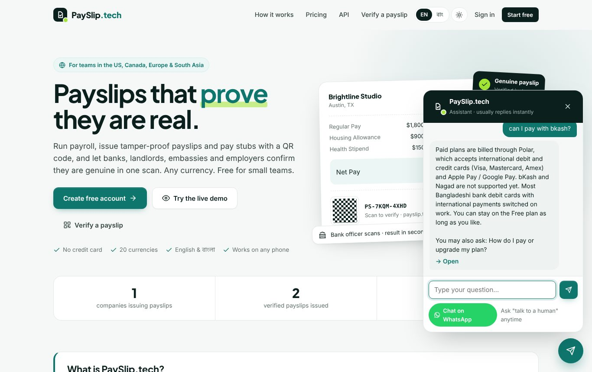
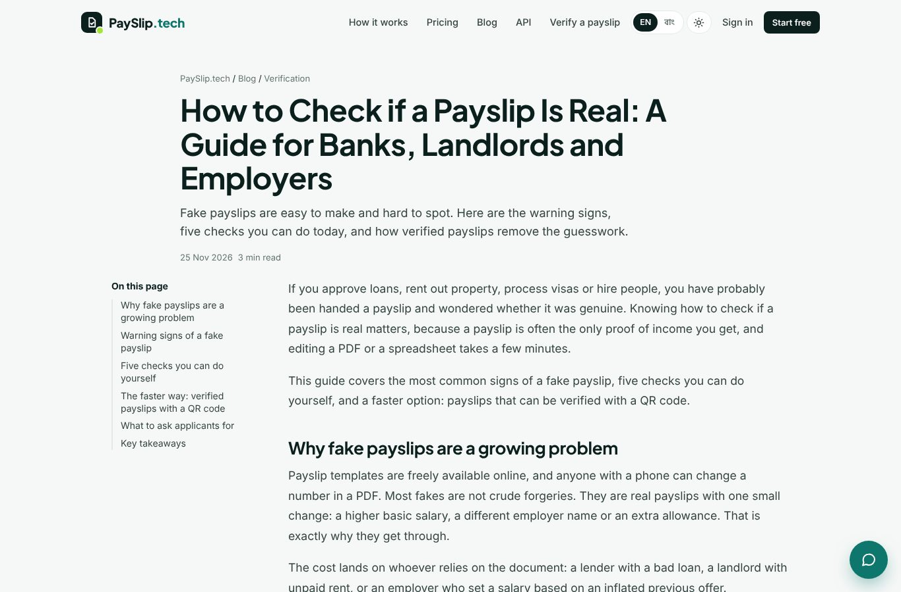

<h1 align="center">PaySlip.tech</h1>

<b>Payroll for small teams, with payslips anyone can verify in seconds.</b> 
Run payroll, issue QR-signed payslips in 20 currencies, and let banks, landlords and embassies check them for free.

  <a href="https://payslip.tech">Live site</a> ·
  <a href="https://payslip.tech/demo">One-click demo</a> ·
  <a href="https://payslip.tech/verify">Verify a payslip</a> ·
  <a href="https://payslip.tech/developers">Verification API</a> ·
  <a href="https://payslip.tech/blog">Guides</a>

---

## The problem

A payslip is the most common proof of income, and anyone can edit one in minutes. Small businesses make payslips in Word or Excel, so lenders, landlords and embassies fall back on bank statements and phone calls to confirm a salary. Honest employees wait days, and employers' names end up on edited copies.

## The solution

Every payslip issued on PaySlip.tech carries a unique code, a QR code and an HMAC-SHA256 signature over its contents. Anyone can scan it or enter the code at [payslip.tech/verify](https://payslip.tech/verify) and see the payslip exactly as the employer issued it, for free and without an account.

| Result | Meaning |
|---|---|
| **Genuine** | Issued by the employer and unchanged |
| **Revoked** | Cancelled by the employer, usually replaced by a corrected payslip |
| **Altered** | The data no longer matches its signature |
| **Not found** | No payslip has that code |

## Features

**Employers**
- Monthly payroll with bonuses, overtime, advances, loans and unpaid days
- Payslips in 20 currencies, English or Bangla, with local terms (payslip, pay stub, salary slip)
- **Verified letters and certificates**: employment letters, salary certificates and yearly income statements with their own QR code, verified like payslips
- **Proof of income links**: employees send a bank or embassy one link with several months of payslips checked live, choosing to show full amounts, only "net pay at least X", or no amounts, with an expiry date and an off switch
- **Employer trust on every check**: verifiers see whether the employer proved it owns its domain, was checked by PaySlip.tech, and how long it has run payroll, so fake companies stand out
- **Team roles and payroll approval**: HR prepares payroll, the accountant or owner approves and issues it, each with their own sign-in
- **Leave and attendance**: leave balances, requests from the employee portal and a monthly attendance sheet; approved unpaid leave flows into payroll
- **Loans and salary advances**: add once with a monthly instalment, deducted automatically until repaid
- **Auto payroll**: drafts prepared before pay day, payslips issued and emailed on pay day
- **Smart assistant**: plain-language commands in English or Bangla (`Rahim bonus 5000, Sadia 2 unpaid days`), always previewed before anything changes; runs on the server with no external AI API
- **Smart import**: any Excel or CSV staff or salary sheet, columns matched automatically
- Custom fields, company branding, revocation and re-issue, verification log

**Employees**
- Self-service portal with every payslip, PDF download and a plain-language "explain my payslip" view

**Verifiers**
- Free web verification and a JSON API (`GET /api/v1/verify/{CODE}`); bank account numbers are never exposed

**Platform**
- Free plan plus paid plans billed through Polar, with monthly limits per plan
- Live chat with a trainable English/Bangla answer bot, hand-off to a human and WhatsApp
- Blog with an SEO checklist, Article/FAQ schema, sitemap, RSS and `llms.txt` for AI search
- Light and dark themes, fully responsive, English and Bangla interface

## Screenshots

| | |
|---|---|
|  |  |
|  |  |
|  |  |
|  |  |

## Security

- HMAC-SHA256 signature on every payslip; any edit is detected
- CSRF protection on every form, strict Content Security Policy and security headers
- TOTP two-factor login with recovery codes, login lockout, hardened sessions
- Secrets encrypted at rest (AES-256-GCM), uploaded images re-encoded, audit log
- Designed to run behind Cloudflare; real client IPs taken only from Cloudflare ranges

Found a security issue? Please email **contact@payslip.tech** instead of opening a public issue.

## Tech stack

Plain PHP 8.1+ (no framework, no Composer) · MySQL / MariaDB · vanilla JavaScript · runs on ordinary shared hosting (cPanel, LiteSpeed or Apache). Database changes apply automatically on upgrade.

## Self-hosting

See **[INSTALL.md](INSTALL.md)** for installation, upgrades, email (SMTP), cron, Cloudflare, Polar billing and SEO setup.

## Author

Built by **Md Bashir Hasan Saikat**, a web developer in Dhaka, Bangladesh. [payslip.tech](https://payslip.tech) · [bashirhasan.com](https://bashirhasan.com)

## License

© 2026 Md Bashir Hasan Saikat. All rights reserved. The source is published for transparency and review; please contact the author before reusing it. Third-party components keep their own licenses (see INSTALL.md).
